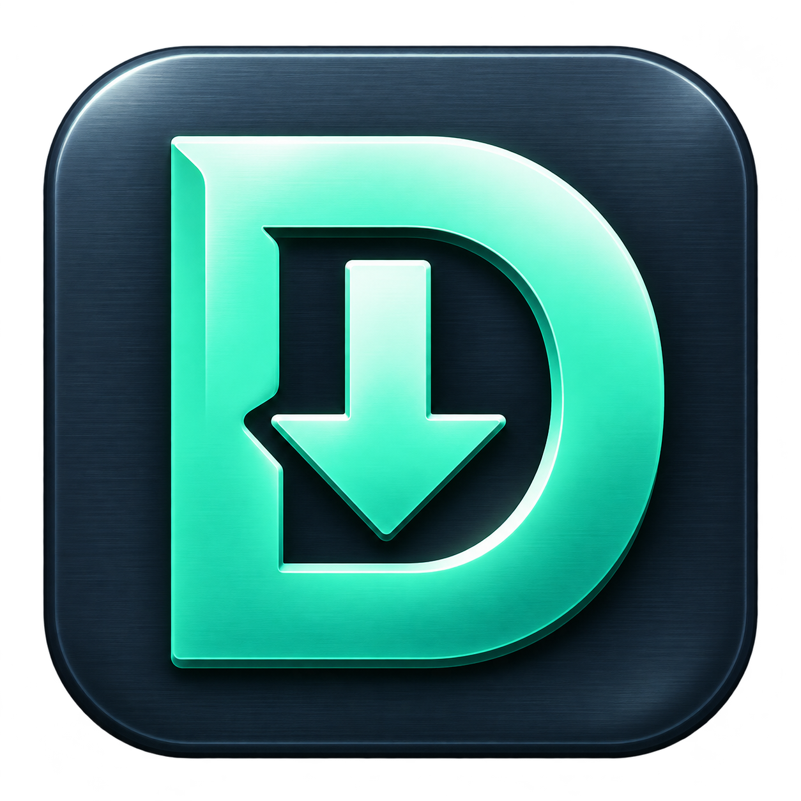
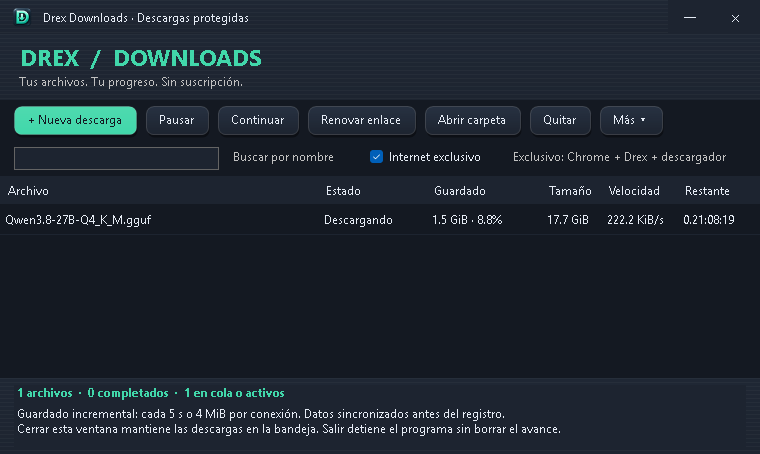

# Drex Downloads

**Gestor local de descargas HTTP/HTTPS para Windows, con recuperación por bloques y protección del progreso.**

Proyecto de [Yoarcy](https://github.com/Yoarcy). Desarrollado en C# / Windows Forms con motor HTTP propio sobre .NET Framework. No depende de IDM, aria2, OpenClaw ni servicios de IA para descargar.

[Descargar versión 1.0.5](https://github.com/Yoarcy/drex-downloads/releases/tag/v1.0.5) · [Manual](LEEME.txt) · [Arquitectura](docs/ARQUITECTURA.md) · [Compilación](docs/BUILD.md)

## Funciones

- Cola secuencial y hasta cuatro conexiones por archivo.
- Pausa, reanudación y renovación manual de enlaces.
- Guardado incremental con doble diario y comprobación SHA-256 por bloques.
- Recuperación de bloques válidos tras interrupciones; los parciales no se eliminan por un error.
- SHA-256 esperado opcional, límites de velocidad y soporte de enlaces de Hugging Face.
- Bandeja del sistema e inicio con Windows opcional.
- Interfaz oscura texturada e icono propio en ventana, ejecutable, bandeja e instalador.
- Modo **Internet exclusivo**, componente opcional y experimental de control de salida de Windows.

## Requisitos e instalación

Windows de escritorio con **.NET Framework 4.8**. Compilación AnyCPU; la ruta de compilación incluida usa el compilador de Windows de 64 bits. No se ha validado una matriz completa de versiones de Windows.

1. Descarga `DrexDownloads-Setup-1.0.5.exe` desde Releases.
2. Ejecuta el instalador y elige una **carpeta vacía** con permisos de escritura.
3. Abre `DrexDownloads.exe`. El instalador no inicia descargas ni cambia el firewall.

También existe un ZIP portable. No requiere Python para el uso normal. Los ejecutables no están firmados digitalmente.

**Internet exclusivo se instala por separado**, con permisos de administrador: consulta [la guía del componente de red](docs/NETWORK.md). El instalador no instala ese componente automáticamente.

## Uso rápido

Pulsa **Nueva descarga**, pega un enlace directo HTTP/HTTPS y selecciona destino. Cerrar la ventana mantiene las descargas en la bandeja; para salir usa **Más → Salir y conservar progreso**. No borres `data/` ni `.drex-partials/` si quieres conservar la recuperación.

## Recuperación y límites

El motor intenta confirmar datos cada 5 segundos o 4 MiB por conexión: primero sincroniza el archivo y luego los diarios. Es un objetivo operativo, **no una garantía de pérdida máxima ante un apagón**. Se han probado fallos de proceso y corrupción controlada, no un corte eléctrico físico.

Reanudar requiere soporte de rangos y validación de identidad/tamaño. No descarga páginas de vídeo, enlaces `blob:`, ni importa parciales privados de IDM. No tiene extensión de navegador. No se garantiza una velocidad superior a otros gestores.

## Estado de las pruebas

- 31 comprobaciones históricas del motor: [resultado](docs/test-results-historical.json).
- En 1.0.5: compilación, interfaz, extracción del instalador e igualdad SHA-256 del ejecutable comprobadas; motor sin cambios respecto al respaldo anterior.
- La suite completa no se volvió a ejecutar para este cambio visual.
- La instalación física en una segunda PC sigue pendiente de validación.
- Casos simulados de portabilidad de red incluidos; aún no se presentan como pruebas aprobadas.

## Estructura

| Ruta | Contenido |
|---|---|
| `src/` | Motor, interfaz, instalador y scripts de compilación |
| `network/` | Supervisor opcional del firewall y registro de tarea |
| `tests/` | Pruebas con servidor HTTP local y recuperación |
| `assets/` | Icono PNG/ICO y prompt de creación |
| `docs/` | Arquitectura, instalación, cambios y evidencias |

## Privacidad

El repositorio y las distribuciones no incluyen descargas, historial de tareas, tokens, enlaces firmados, snapshots del firewall ni respaldos del equipo del autor. Los tokens opcionales de Hugging Face se protegen con el usuario de Windows; no compartas tu carpeta de datos.

## Desarrollo y contribuciones

Consulta [BUILD.md](docs/BUILD.md). Reporta errores con pasos reproducibles y sin datos privados. No hay licencia de código abierto concedida en esta publicación; la disponibilidad del código no implica permiso general de redistribución o modificación. La licencia queda pendiente de decisión del titular.
